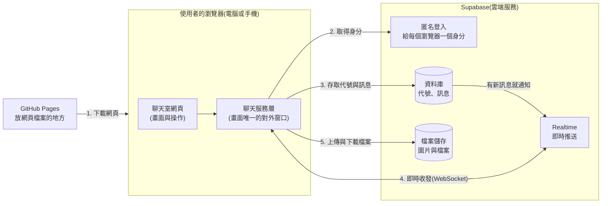
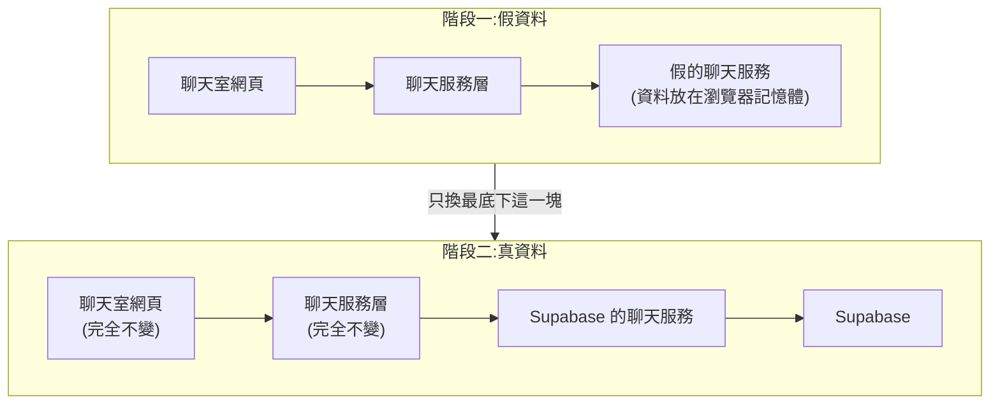

# 匿名聊天室 架構文件

這份文件說明聊天室「要怎麼做」。「要做什麼」寫在 [requirements.md](requirements.md)。

文件裡的專有名詞,第一次出現時都會用一句話解釋。文件裡沒有任何程式碼,只有說明、表格和圖。

---

## 1. 專案說明與目標

### 這是什麼
一個不用註冊、不用登入的匿名聊天室。只要知道網址,用電腦或手機打開,輸入一個代號,就能跟所有在線的人聊天。全世界只有一間聊天室。

### 目標
- 打開網頁、取一個代號、馬上能聊。
- 可以傳文字、圖片、檔案;可以收回自己傳的訊息。
- 看得到誰在線上、誰進來、誰離開。
- 手機和電腦都好用。
- 介面有五種語言:繁體中文、简体中文、English、한국어、日本語。
- 不用自己架伺服器,網頁放在 GitHub Pages,即時傳訊交給 Supabase。

### 已確定的行為(需求訪談的結論)

**進入與代號**
- 輸入代號才能進入。代號 1 到 12 個字,前後空白會自動去掉,英文大小寫視為相同(Amy 和 amy 是同一個代號)。
- 代號**永久綁定第一個使用它的瀏覽器**,不會被釋出,別人不能用。
- 已經有代號的瀏覽器,下次打開直接進聊天室,不用再輸入。
- 重新整理頁面或網路短暫斷線,會自動回到聊天室。30 秒內回來,別人不會看到「離開了、進來了」的提示。

**訊息**
- 可以傳文字、圖片、檔案。網址會自動變成可以點的連結。單一檔案上限 5 MB。
- 每則訊息顯示:代號、時間、代號專屬的顏色。自己的訊息靠右,別人的靠左。
- 新進來的人看得到最近 100 則歷史訊息。
- 可以收回自己的訊息,沒有時間限制,不能編輯。收回後所有人(包含之後才進來的人)都只看到「已收回」。
- 短時間內送太多則,送出鈕會暫時停用。
- 有人在打字時,底部顯示「某某 正在輸入…」。

**畫面**
- 有人進來或離開時,聊天中間出現一行灰色小字,不會被保存。
- 電腦版:線上名單固定在側邊。手機版:左上角顯示「線上 N 人」和幾個代號,點一下展開完整名單。
- 新訊息進來時,不會自動捲動畫面,而是在右下角出現「↓ 有 N 則新訊息」按鈕,點了才捲到最底。自己送出訊息時例外,一定捲到最底。分頁標題會顯示未讀數。
- 依瀏覽器語言自動選介面語言,也可手動切換並記住。跟隨裝置的淺色或深色模式。

---

## 2. 整體架構圖



### 怎麼看這張圖
- **GitHub Pages**:GitHub 提供的免費「網頁放置處」。它只負責把網頁檔案交給瀏覽器,**不處理任何聊天內容**。
- **Supabase**:一個雲端服務,把資料庫、即時傳訊、檔案儲存等功能打包好給我們用,不必自己架伺服器。聊天的所有內容都在這裡。
- **WebSocket**:瀏覽器和伺服器之間一條「一直開著的連線」。有新訊息時,伺服器可以馬上推過來,不用瀏覽器一直去問「有新的嗎?」。
- **聊天服務層**:網頁裡的一個「窗口」。畫面要做任何跟聊天有關的事(送訊息、取歷史、知道誰在線上),都只對這個窗口說話,不直接碰 Supabase。這是後面第 4 節「階段一換階段二不用重寫」的關鍵。

**重點**:使用者的瀏覽器會直接跟 Supabase 溝通,中間沒有我們自己的伺服器。所以「誰可以做什麼」的規則必須設在 Supabase 那一邊(見第 9 節),不能只靠網頁程式。

---

## 3. 技術選擇

每一項都寫「選了什麼」和「為什麼」。

### 3.1 前端(使用者看到的網頁)

**選了什麼**:Vite + React + TypeScript
- **React**:很多網站使用的畫面程式庫,把畫面拆成一塊一塊的小零件(訊息、線上名單、輸入框……)。
- **TypeScript**:JavaScript(網頁的程式語言)的加強版,會在寫程式時就檢查「資料的形狀有沒有對」,減少錯誤。
- **Vite**:把這些程式整理、打包成瀏覽器能直接開的網頁檔案的工具。

**為什麼**
- GitHub Pages 只能放「做好的靜態檔案」,不能跑伺服器程式。Vite 做出來的正好是這種檔案。
- 聊天室的畫面狀態很多(訊息、線上名單、誰在打字、未讀數、連線狀態),React 的零件做法最容易管理。
- 這個專案只有一個頁面,不需要更重的框架(例如 Next.js,那是需要伺服器的)。
- 這是最常見的組合,遇到問題時資料多、容易找答案。

### 3.2 多語言

**選了什麼**:i18next(專門處理「多語言切換」的工具)

**為什麼**:成熟穩定,內建「依瀏覽器語言自動選」和「記住使用者選擇」。五種語言的文字各放一個檔案,之後加語言只要加檔案。

### 3.3 後端(Supabase 的哪些功能)

| 需要的事 | 用 Supabase 的什麼 | 一句話說明 | 為什麼 |
| --- | --- | --- | --- |
| 分辨是誰 | **匿名登入**(Anonymous Sign-Ins) | 使用者不用輸入任何帳密,Supabase 自動給這個瀏覽器一個「身分編號」,記在瀏覽器裡 | 「代號綁定瀏覽器」和「只能收回自己的訊息」都需要一個伺服器信得過的身分。匿名登入使用者完全無感,又能辦到 |
| 存代號與訊息 | **Postgres 資料庫** | Supabase 內建的資料庫,像很多張表格 | 需要歷史訊息和收回,訊息必須存起來 |
| 即時收到新訊息 | **Realtime 的 Postgres Changes** | 資料庫有新增或修改時,自動即時通知所有人 | 「存起來」和「通知大家」是同一個動作,不會出現「存了但沒通知」或「通知了但沒存」 |
| 線上名單、進出提示 | **Realtime 的 Presence** | 每個人連上時登記「我在線上」,斷線時自動被移除 | 不用自己做「定時回報我還活著」的機制 |
| 「正在輸入」 | **Realtime 的 Broadcast** | 傳一則「用完即丟」的訊息給所有人,不存資料庫 | 打字狀態只有幾秒有用,存起來沒意義 |
| 圖片與檔案 | **Storage**(檔案儲存) | 專門放檔案的空間 | 大檔案不該塞進資料庫 |
| 規定誰能做什麼 | **RLS**(Row Level Security,資料列層級安全) | 在資料庫上設定「誰可以讀、寫哪些資料」的規則,由 Supabase 強制執行 | 沒有自己的伺服器,規則只能放在這裡,是整個專案安全的根基 |

---

## 4. 兩個階段

使用者指定的順序:**先把前端做好、放上 GitHub Pages 看得到,最後才接上 Supabase。**



### 4.1 階段一:還沒接 Supabase

**能做到什麼程度**:整個聊天室的畫面和操作,幾乎都能做出來並實際操作,只是「對方」是假的。

| 功能 | 階段一的做法 |
| --- | --- |
| 輸入代號、重複代號會被擋 | 可以。但只檢查「這個瀏覽器已知的代號」,不是真正的全世界唯一 |
| 下次打開自動進入 | 可以。代號記在瀏覽器裡 |
| 送文字、圖片、檔案 | 可以。圖片和檔案只存在這個分頁的記憶體裡,重新整理就消失。5 MB 的大小檢查有效 |
| 歷史訊息、收回 | 可以。資料放瀏覽器裡 |
| 線上名單、進出提示 | 可以,由假資料產生 |
| 「正在輸入」、新訊息按鈕、分頁標題未讀數 | 可以 |
| 連線中斷橫幅 | 可以,用示範控制面板模擬 |
| 五種語言、淺色深色、手機版 | 完全可以 |
| **真的跟別人聊天** | **不行**。要到階段二才行 |

**怎麼在 GitHub Pages 上看得到效果**
1. 把階段一的網頁部署到 GitHub Pages(做法見第 12 節),就有一個公開網址可以用手機和電腦打開。
2. 為了讓一個人也能看到「很多人在聊」的樣子,加入**示範模式**:網址後面加上示範標記時,會出現幾位**假的聊天對象**,他們會定時說話、進來、離開。畫面上會清楚標示「示範模式」,避免誤以為是真人。
3. 同一台電腦開兩個分頁,兩個分頁會互相看到對方的訊息(瀏覽器內建的 **BroadcastChannel** 功能,可以讓同一個瀏覽器的不同分頁互相傳話)。
4. 示範模式另有一個**示範控制面板**,可以手動觸發「斷線」「檔案太大」「被擋的重複代號」等情況,方便檢查每個畫面狀態。

### 4.2 階段二:接上 Supabase 之後的改變

- 「假的聊天服務」換成「Supabase 的聊天服務」。示範模式與假聊天對象移除(或只在開發時保留)。
- 資料變成真的:代號全世界唯一、訊息所有人共用、歷史訊息跨裝置、檔案真的上傳雲端。
- 新增要做的事:在 Supabase 建專案、設定規則、填入金鑰(第 8 節)。
- 使用者看到的畫面和操作**完全不變**。

### 4.3 兩個階段之間,前端怎麼設計才不用重寫

做法:**畫面只和「聊天服務層」說話,而且雙方先約定好說話的規矩**(第 5 節就是這份規矩)。

- 畫面不知道、也不關心背後是假資料還是 Supabase。
- 假的服務和真的服務**遵守同一份約定**:收到同樣的請求,回同樣形狀的答案,發出同樣名稱的事件。
- 換階段時,只有一個開關:有填 Supabase 的金鑰就用真的,沒有就用假的。
- 這就像家裡的插座:電器(畫面)只管插插座,後面接的是發電機(假的)還是電廠(Supabase),電器不用改。

這樣做的另一個好處:階段一寫的畫面測試,階段二還能繼續用。

---

## 5. 通訊約定

這是「畫面」與「聊天服務層」之間的規矩,也是之後 Supabase 要對上的規格。階段一的假服務和階段二的真服務都照這份做。

### 5.1 畫面可以對服務下的指令

| 指令 | 做什麼 | 可能的結果 |
| --- | --- | --- |
| 啟動 | 還原這個瀏覽器的身分,看有沒有已登記的代號 | 有代號 / 沒有代號 |
| 登記代號 | 申請使用某個代號 | 成功 / 已被使用 / 格式不合 |
| 取歷史訊息 | 取最近 100 則 | 訊息清單 |
| 送文字 | 送出一則文字訊息 | 成功 / 太快了 / 太長 |
| 送檔案 | 送出圖片或檔案 | 成功 / 檔案太大 / 太快了 / 上傳失敗 |
| 收回 | 收回自己的一則訊息 | 成功 / 不是你的訊息 |
| 我在打字 | 通知大家我正在輸入 | (不需要回應) |

### 5.2 服務會通知畫面的事件

| 事件名稱 | 什麼時候發生 | 帶的資料 |
| --- | --- | --- |
| `message-added` | 有人送出新訊息(包含自己的) | 一則訊息(5.3) |
| `message-recalled` | 有人收回訊息 | 訊息編號(內容已被清空) |
| `user-joined` | 有人進入聊天室 | 代號 |
| `user-left` | 有人離開(已確定超過 30 秒沒回來) | 代號 |
| `presence-changed` | 線上名單有任何變動 | 完整的線上名單 |
| `typing` | 有人正在打字 | 代號 |
| `connection-changed` | 連線狀態改變 | 狀態(連線中 / 已中斷 / 重新連線中) |

> 「離開」的 30 秒緩衝由前端處理:服務層一收到對方斷線,就開始等 30 秒,期間對方又回來就不發 `user-left`。

### 5.3 訊息的資料格式

| 欄位 | 說明 | 範例 |
| --- | --- | --- |
| 編號 | 每則訊息唯一的編號 | 一串隨機字母數字 |
| 發送者身分編號 | 匿名登入給的身分,用來判斷「是不是自己的」 | 一串隨機字母數字 |
| 代號 | 發送時的代號 | 小明 |
| 類型 | `text`(文字)/ `image`(圖片)/ `file`(其他檔案) | `text` |
| 文字內容 | 文字訊息的內容,上限 4000 字 | 大家好 |
| 檔案資訊 | 檔名、大小、類型、儲存位置(只有圖片與檔案才有) | `photo.jpg`, 2.1 MB |
| 送出時間 | 由伺服器記錄,不用使用者的手機時間 | 2026-10-13 14:32 |
| 收回時間 | 空的代表沒被收回。有值代表已收回,此時文字內容與檔案資訊都已清空 | 空 |

### 5.4 線上名單的資料格式
每位在線的人只有一個欄位:**代號**。同一個人開兩個分頁只算一位。

### 5.5 「正在輸入」的資料格式
只有**代號**。接收方收到後顯示 3 秒,沒有再收到就消失。傳送方最多每 2 秒傳一次,避免太頻繁。

### 5.6 錯誤種類
`nickname-taken`(代號已被使用)、`nickname-invalid`(格式不合)、`rate-limited`(送太快)、`too-large`(檔案太大)、`not-owner`(不是你的訊息)、`offline`(沒連線)。畫面依照這些種類顯示對應語言的提示,服務不直接傳文字。

> 這也是為什麼進出提示、收回提示等文字都**不存在資料庫**:服務只傳「誰、發生什麼」,畫面再依每個人的語言組成句子。

---

## 6. 資料流

### 6.1 進入聊天室
1. 使用者打開網址,瀏覽器從 GitHub Pages 下載網頁。
2. 網頁啟動聊天服務。服務檢查瀏覽器裡有沒有身分:
   - 沒有(第一次來):向 Supabase 要一個匿名身分,存在瀏覽器裡。
   - 有:直接用。
3. 服務查這個身分有沒有登記過代號:
   - **有**:跳過代號頁,直接進入第 5 步。
   - **沒有**:顯示代號輸入頁。
4. 使用者輸入代號:
   - 先在網頁檢查格式(長度、空白、不可使用的字元),不合就即時顯示原因。
   - 通過後送給 Supabase 登記。資料庫會再檢查一次,並確保代號全站唯一(不分大小寫)。
   - 若兩個人同時搶同一個代號,資料庫保證只有一個成功,另一個會看到「這個代號有人在用了」。
5. 進入聊天室:
   - 取最近 100 則歷史訊息顯示。
   - 連上即時頻道,登記「我在線上」,並開始接收新訊息、線上名單、輸入中的通知。
   - 其他人會收到「某某 進來了」。
   - 自己進來時,畫面同步名單的過程中,不會對已在線的每個人都跳「進來了」(同步完成前的通知一律忽略)。

### 6.2 送出訊息
**文字**
1. 使用者按送出(電腦版也可按 Enter;Shift+Enter 換行。手機版 Enter 是換行)。
2. 網頁先檢查:不是空白、沒超過 4000 字、沒被「送太快」暫停。
3. 送給 Supabase 存起來。資料庫自己填上代號和時間(使用者無法偽造),並再次檢查頻率。
4. 存好後,Supabase 即時通知所有人(包含自己),大家的畫面各自加入這則訊息。
5. 自己的畫面捲到最底;別人的畫面出現「↓ 有 N 則新訊息」按鈕。

**圖片或檔案**
1. 網頁先檢查大小是否超過 5 MB,超過就在送出前提示。
2. 先上傳到檔案儲存。上傳成功後,才送出一則「引用這個檔案」的訊息。
3. 後續與文字相同。圖片會直接顯示,點一下放大;其他檔案顯示檔名與下載按鈕。
4. 如果檔案上傳了但訊息送失敗,網頁會把剛上傳的檔案刪掉,避免留下孤兒檔案。

**收回**
1. 使用者在自己的訊息上選「收回」。
2. 服務請 Supabase 收回。伺服器確認這則訊息是這個身分發的,才把內容**在資料庫裡清空**並記下收回時間(不是只在畫面上藏起來)。
3. 如果有檔案,一併從檔案儲存刪除。
4. 所有人收到 `message-recalled`,該則訊息變成「某某 收回了一則訊息」。之後才進來的人讀到的歷史訊息也是這個樣子。

### 6.3 離開
1. 使用者關掉分頁或瀏覽器。
2. 即時頻道偵測到斷線,自動把這個人從線上名單移除。其他人的畫面名單即時更新。
3. 其他人的畫面**等 30 秒**才顯示「某某 離開了」。
4. 離開後,**代號仍然屬於他**,別人不能使用。名單上只顯示在線的人。

### 6.4 斷線重連
1. 網路中斷(例如電梯裡、切換 Wi-Fi、手機切到別的 App 一陣子):畫面上方出現「連線中斷,重新連線中…」。輸入框的內容保留。
2. 連線程式庫會自動不斷嘗試重連。
3. 重連成功後:
   - 橫幅消失。
   - 重新取最近 100 則訊息,和畫面上的合併,**補回斷線期間漏掉的新訊息和收回**。
   - 重新登記「我在線上」。
4. 其他人這段期間:
   - 若斷線不到 30 秒:看不到任何進出提示。
   - 超過 30 秒:會看到「某某 離開了」,他回來後再看到「某某 進來了」。
5. 如果使用者其實是**重新整理頁面**,流程回到 6.1:身分和代號都還在,直接進入聊天室。

---

## 7. 畫面清單

只描述有什麼元素、各自的行為,顏色與樣式由 `/design` 決定。

### 7.1 代號輸入頁
| 元素 | 行為 |
| --- | --- |
| 標題與簡短說明 | 說明這是匿名聊天室 |
| 語言選單 | 切換介面語言,選擇會被記住 |
| 代號輸入框 | 即時檢查格式,不合時在輸入框下方顯示原因(例如「代號最多 12 個字」) |
| 進入按鈕 | 格式不合時不能按。按下後登記代號;進行中顯示等待狀態,避免連按 |
| 錯誤提示 | 「這個代號有人在用了」等,依錯誤種類顯示 |
| 連線失敗提示 | 無法連到伺服器時顯示,可重試 |

只有「第一次來」或「代號還沒登記」的人會看到這一頁。

### 7.2 聊天室主畫面

**頂部**
| 元素 | 行為 |
| --- | --- |
| 手機版:左上角線上摘要 | 顯示「線上 N 人」與幾個代號;點一下展開完整名單 |
| 語言選單 | 同上 |
| 連線橫幅 | 斷線時出現,恢復後消失 |

**線上名單**(電腦版固定在側邊,手機版是展開的面板)
| 元素 | 行為 |
| --- | --- |
| 人數 | 「線上 N 人」,隨進出即時更新 |
| 代號清單 | 每個人顯示自己的代號顏色。自己那一項後面標示「(你)」 |

**訊息區**
| 元素 | 行為 |
| --- | --- |
| 文字訊息 | 顯示代號、時間、內容。網址可點(在新分頁開啟) |
| 圖片訊息 | 直接顯示縮小的圖,點一下進入放大檢視 |
| 檔案訊息 | 顯示檔名、大小、下載按鈕 |
| 自己與別人的訊息 | 自己靠右、別人靠左,代號各有固定顏色 |
| 自己訊息上的「收回」 | 只有自己的訊息有。先要求確認一次,避免誤觸;確認後收回 |
| 已收回的訊息 | 顯示灰色小字「某某 收回了一則訊息」,看不到原內容 |
| 進出提示 | 一行灰色小字「某某 進來了 / 離開了」,跟著訊息一起往上捲,不保存 |
| 「↓ 有 N 則新訊息」按鈕 | 有新訊息時出現在右下角,點了捲到最底並消失。自己送出訊息時畫面直接捲到最底 |
| 載入中與空狀態 | 剛進來載入歷史訊息時顯示等待;沒有歷史訊息時顯示一句歡迎提示 |

**底部**
| 元素 | 行為 |
| --- | --- |
| 「正在輸入」提示列 | 1 到 3 人列出代號;超過 3 人顯示「有多人正在輸入…」;停止輸入 3 秒後消失 |
| 輸入框 | 可多行。手機版固定在畫面底部,不會被鍵盤蓋住 |
| 附加檔案按鈕 | 選擇圖片或檔案。超過 5 MB 時在送出前提示 |
| 送出按鈕 | 內容為空時不能按;被「送太快」限制時暫時停用並顯示「送太快了,請稍等」 |

### 7.3 圖片放大檢視
| 元素 | 行為 |
| --- | --- |
| 放大的圖片 | 點圖片外或關閉鈕離開 |
| 下載按鈕 | 下載原圖 |

### 7.4 瀏覽器分頁
| 元素 | 行為 |
| --- | --- |
| 分頁標題 | 有未讀訊息時顯示「(3) 匿名聊天室」,全部看過後恢復 |

### 7.5 階段一專屬:示範控制面板
只在示範模式出現。可以手動觸發斷線、重連、檔案太大、代號被占用等,用來檢查每個畫面狀態。階段二移除。

---

## 8. 金鑰

「金鑰」可以想成「讓程式證明自己有權限的一段密碼字串」。這個專案會碰到的東西如下。

| 名稱 | 是什麼 | 怎麼產生 | 放在哪裡 | 可以公開嗎 |
| --- | --- | --- | --- | --- |
| **Project URL** | 這個 Supabase 專案的網址 | 建立專案時 Supabase 自動給 | 本機 `.env.local` 檔案;GitHub 上設定成 Actions 變數 | **可以** |
| **Publishable key**(可公開金鑰,舊名 anon key) | 讓瀏覽器連上這個專案的鑰匙,權限受第 9 節的規則限制 | 建立專案時 Supabase 自動給 | 同上 | **可以**。設計上本來就要放進網頁給大家用 |
| **Secret key / service_role key**(祕密金鑰) | 繞過所有權限規則的萬能鑰匙 | Supabase 自動給 | **這個專案根本不用,不要放進專案、不要放 GitHub、不要貼給任何人或 AI** | **絕對不能** |
| **資料庫密碼** | 直接連資料庫用的密碼 | 建立專案時自己設定 | 只放自己的密碼管理工具 | **絕對不能** |

### 為什麼 publishable key 可以公開
它最後一定會被包進網頁裡,任何人按右鍵「檢視原始碼」都看得到,沒辦法藏。安全不是靠藏起來,而是靠 Supabase 上的 **RLS 規則**:就算有人拿著這把鑰匙,也只能做規則允許的事(讀歷史訊息、送自己的訊息、收回自己的訊息)。所以**RLS 規則一定要設對,是這個專案最重要的安全設定**。

### 金鑰從哪裡拿
Supabase 後台 → 專案設定 → API(或 API Keys)。這些都不需要我們「產生」,建專案時就有了。

### 怎麼避免被 commit 到 GitHub
**commit** 是把檔案的變更記錄進 Git(版本管理工具);一旦進了 GitHub,就視為公開,而且刪掉也還留在歷史紀錄裡。

1. **本機**:金鑰放 `.env.local`,並在 `.gitignore`(告訴 Git「不要追蹤這些檔案」的清單)列入所有 `.env*` 檔。
2. **repo 裡**只放 `.env.example`,內容只有變數名稱,沒有真正的值。
3. **部署時**:在 GitHub repo 的 Settings → Secrets and variables → Actions 設定變數,由部署流程在打包時帶入。
4. **開啟 GitHub 的 Secret scanning 與 Push protection**(自動偵測並阻擋把金鑰推上去的功能)。
5. **Secret key 和資料庫密碼不會出現在專案裡**,所以即使不小心也沒有東西可以洩漏。
6. **萬一洩漏了**:馬上到 Supabase 後台重新產生(輪替)該金鑰,舊的立刻失效。

> GitHub Pages 的免費版要求 repo 是**公開**的,所以這個 repo 會被所有人看到。這是上面要這麼嚴格的原因之一。

---

## 9. 安全與限制

### 9.1 別人可能送什麼奇怪的東西進來,前端怎麼擋

> 原則:**前端的檢查只是為了讓正常使用者有好的體驗。真正的防線在 Supabase**,因為壞人可以不透過我們的網頁,直接對 Supabase 發請求。所以每一項都有「前端」和「後端」兩層。

| 可能的情況 | 前端怎麼擋 | 後端怎麼擋 |
| --- | --- | --- |
| **訊息裡夾帶網頁程式碼**(想讓別人的瀏覽器執行,稱 XSS) | 所有文字都當成「純文字」顯示,不當成網頁解讀 | (顯示端負責) |
| **假連結**(例如點了會執行程式的網址) | 只有 `http://` 與 `https://` 開頭才變成連結,其他不轉;連結都在新分頁開啟,並不帶來源資訊 | 無 |
| **超長訊息** | 超過 4000 字不給送 | 資料庫也限制 4000 字 |
| **洗版**(狂送) | 10 秒內超過 5 則,暫停送出鈕並提示 | 資料庫同樣限制頻率,繞過網頁也沒用 |
| **一長串沒有空格的字,撐破版面** | 長字串自動換行 | 無 |
| **假冒別人的代號發訊息** | 無法指定 | 代號由資料庫從「這個身分的登記資料」自動帶入,不接受請求裡寫的代號 |
| **假冒系統訊息**(例如代號取名叫「某某 離開了」) | 進出提示和一般訊息外觀分開 | 代號限制 1 到 12 字,不能含換行、控制字元、肉眼看不見的字元 |
| **看不見的字元當代號**(兩個「長得一樣」的代號) | 輸入時檢查並提示 | 資料庫也檢查,代號不分大小寫唯一 |
| **收回或改別人的訊息** | 只有自己的訊息才顯示收回 | 沒有任何人可以直接修改或刪除訊息,收回只能走專用流程,伺服器確認是發送者本人 |
| **超大檔案** | 超過 5 MB 送出前擋下 | 檔案儲存空間本身有上限 5 MB |
| **偽裝檔案**(副檔名寫 jpg 但其實不是) | 只有伺服器標示為圖片的才當圖片顯示,其他當一般檔案提供下載 | 無 |
| **SVG 圖檔**(可能夾帶程式) | 一律當一般檔案(下載),不直接顯示 | 無 |
| **知道檔案網址的外人亂載** | 無 | 檔案儲存是私有的,下載網址 1 小時就過期;訊息被收回後,不會再給新網址 |
| **沒有代號的人偷看聊天內容** | 無 | 必須先登記代號才能讀訊息 |
| **大量製造匿名身分** | 無 | 靠 Supabase 內建的速率限制;若真的被濫用,再加人機驗證(CAPTCHA,「我不是機器人」) |
| **不當內容**(圖片、言論) | 本版不做過濾與檢舉 | 管理者(你)只能到 Supabase 後台手動刪除,見第 10 節 |

### 9.2 免費方案有哪些上限要注意

以下是 Supabase 免費方案的限制。我在 2026-10-13 查過官方文件,**實際數字隨時可能調整**,正式上線前請再核對一次。

| 項目 | 免費方案的上限 | 對聊天室的影響 |
| --- | --- | --- |
| 同時連線數 | 200 | 同時最多約 200 個人在線,超過的人連不上即時功能 |
| 即時訊息速率 | 每秒 100 則 | 超過會被斷線(程式庫會自動重連)。人多又都在聊天、打字時要留意 |
| 即時訊息總量 | 每月 200 萬則 | 一則訊息要通知 N 個人,可能會算成多則;「正在輸入」也會算,所以我們把它限制在最多每 2 秒一次。實際怎麼計算要上線後觀察 |
| 檔案儲存空間 | 1 GB | 每個檔案都傳滿 5 MB 的話,約 200 個就用完。是最容易先爆的上限 |
| 單一檔案大小 | 50 MB(平台上限) | 我們設 5 MB,在允許範圍內 |
| 資料庫大小 | 500 MB | 文字訊息很小,不太會先滿 |
| **閒置暫停** | 專案**一週沒有足夠活動**會被暫停 | 暫停後聊天室無法使用,需要到後台手動恢復。如果聊天室不是天天有人用,這點很重要 |
| 免費專案數量 | 每個帳號 2 個 | 不影響 |

GitHub Pages 這邊也有限制(以 GitHub 官方說明為準):網站大小約 1 GB 以內、每月流量約 100 GB 的軟性上限。這個專案的網頁很小,不太可能碰到。

資料來源:
- [Supabase Realtime Limits](https://supabase.com/docs/guides/realtime/limits)
- [Supabase 價格頁](https://supabase.com/pricing)
- [Supabase 免費專案暫停說明](https://supabase.com/docs/guides/platform/free-project-pausing)
- [Supabase 計費說明](https://supabase.com/docs/guides/platform/billing-on-supabase)

### 9.3 其他已知限制
- **清除瀏覽器資料就拿不回代號**:沒有登入,無法證明你是同一個人。這是「代號永久綁定瀏覽器」的代價。
- **換裝置要用新代號**:同一個人用手機和電腦,會被當成兩個人。
- **代號會越用越少**:代號永不釋出,好用的代號會被占光。
- **字數的算法**:代號的「1 到 12 字」以 Unicode 字元計算,某些複合表情符號(如家庭、膚色變化)內部由多個字元組成,會被算成多個字。
- **資料庫會一直累積訊息**:畫面只讀最新 100 則,舊的永遠不會被看到。之後可加排程定期清除。
- **訊息文字上限 4000 字**:這是我加的,需求只說內容不限,可以調整。

---

## 10. 這一版刻意不做的事

| 不做 | 為什麼 |
| --- | --- |
| 註冊、登入、帳號找回 | 需求明確不要。代號只靠瀏覽器綁定,所以也不提供找回 |
| 編輯已送出的訊息 | 需求只要求收回;編輯會讓「大家看到的內容是否一致」變複雜 |
| 檢舉、封鎖、髒話過濾 | 訪談時確認不做。代價是不當內容只能由管理者到 Supabase 後台手動刪除 |
| 管理員介面 | 沒有登入就沒有「管理員」的概念,先不做。需要時直接用 Supabase 後台操作 |
| 訊息翻譯 | 只有介面文字有多語言,別人傳的訊息不翻譯 |
| 私訊、多個聊天室 | 需求是「所有人在同一個聊天室」 |
| 回覆、引用、@提及、表情回應 | 需求沒提到,先保持簡單 |
| 已讀回條 | 匿名多人聊天室意義不大 |
| 瀏覽器推播通知 | 需要額外的權限與設定,先不做;用分頁標題未讀數代替 |
| 訊息搜尋 | 沒有需求,且歷史只有最近 100 則 |
| 圖片自動縮圖與壓縮 | 先用原圖。若流量或空間吃緊再加 |
| 自動清除舊資料 | 先觀察實際用量。第 9.3 節已列為已知限制 |

---

## 11. repo 的資料夾結構

**repo**(repository)就是放整個專案檔案、並由 Git 記錄變更的資料夾。

```
yun/
├─ README.md                       專案簡介與如何開始
├─ docs/
│   ├─ requirements.md             需求說明
│   └─ architecture.md             本文件
├─ src/                            網頁的程式碼
│   ├─ screens/                    7 個畫面對應的程式(代號頁、聊天室、圖片放大)
│   ├─ components/                 畫面裡的小零件(訊息、線上名單、輸入框……)
│   ├─ service/                    「聊天服務層」
│   │   ├─ contract                第 5 節的約定(指令、事件、資料格式)
│   │   ├─ mock/                   階段一的假服務與示範模式
│   │   └─ supabase/               階段二的 Supabase 服務
│   ├─ i18n/                       五種語言的文字檔
│   ├─ rules/                      代號格式、網址轉連結、顏色計算等共用規則
│   └─ main                        網頁入口
├─ supabase/
│   └─ migrations/                 階段二要在 Supabase 建立的資料表與規則(SQL 檔)
├─ public/                         圖示等靜態檔案
├─ .github/
│   └─ workflows/                  自動部署到 GitHub Pages 的設定
├─ .env.example                    金鑰變數名稱範本(沒有真正的值)
├─ .gitignore                      列出不能進 Git 的檔案(包含 .env*)
└─ 專案設定檔                      Vite、TypeScript 等工具的設定
```

`.env.local`(放真正金鑰的檔案)只存在自己電腦上,**不在 repo 裡**。

---

## 12. 部署到 GitHub Pages 的方式

**部署**就是把做好的網頁放到網路上讓別人打開。

### 運作方式
用 **GitHub Actions**(GitHub 內建的自動化功能,有人推送程式碼時自動執行一串工作)。流程:
1. 你把程式碼推到 `main` 分支。
2. GitHub Actions 自動執行:安裝工具 → 打包網頁(階段二時帶入 Supabase 的公開金鑰)→ 把成品交給 GitHub Pages。
3. 約一兩分鐘後,新版網頁上線。

### 一次性的設定
1. repo 必須是**公開**的(GitHub 免費版的 Pages 要求)。
2. 到 repo 的 Settings → Pages,把來源(Source)選成 **GitHub Actions**。
3. 階段二:到 Settings → Secrets and variables → Actions → Variables,新增 Project URL 和 Publishable key 兩個變數。

### 網址與要注意的地方
- 網址形式是 `https://<GitHub 帳號>.github.io/<repo 名稱>/`。
- 網頁是放在「repo 名稱」這個**子路徑**下,所以打包時要告訴 Vite 這個路徑,否則會找不到樣式與圖片檔,畫面一片空白。這是 GitHub Pages 最常見的陷阱。
- 這個專案只有一個頁面,不需要處理「重新整理後找不到頁面」的問題。
- 修改後若沒更新,先強制重新整理(清快取)。

---

## 13. 驗證清單

做完才算數:每一項都要實際操作確認。

### 階段一(假資料)
**部署**
- [ ] 推送程式碼後,GitHub Actions 成功,GitHub Pages 網址能打開,畫面不是空白。
- [ ] 電腦、手機各打開一次,畫面正常。

**進入與代號**
- [ ] 第一次進來看到代號頁;空白、超過 12 字、含看不見字元都會被擋並顯示原因。
- [ ] 英文大小寫視為相同(輸入 Amy 後再輸入 amy 會被擋)。
- [ ] 重複代號時顯示「這個代號有人在用了」。
- [ ] 登記後關掉再打開,直接進入聊天室。

**訊息**
- [ ] 送出文字:自己的在右、別人的在左,有代號、時間、顏色。
- [ ] 網址變成可點連結,以新分頁開啟;非 http/https 的網址不會變成連結。
- [ ] 夾帶網頁程式碼的文字會原樣顯示,不會被執行。
- [ ] 超過 4000 字不能送出。
- [ ] 圖片直接顯示、點一下可放大;其他檔案顯示檔名與下載按鈕;超過 5 MB 送出前被擋並提示。
- [ ] 收回:出現確認;收回後顯示灰色「已收回」;重新整理後依然是「已收回」。
- [ ] 10 秒內連送超過 5 則,送出鈕暫停並提示。
- [ ] 電腦版 Enter 送出、Shift+Enter 換行;手機版 Enter 換行。

**線上與提示**
- [ ] 線上名單顯示人數與代號,自己標示「(你)」。
- [ ] 示範模式下,假的聊天對象進來、離開時,出現灰色提示。
- [ ] 同一台電腦開兩個分頁,互相看得到訊息與上線。
- [ ] 「正在輸入」:1 到 3 人列名字,超過 3 人顯示「有多人」,停止後消失。

**畫面行為**
- [ ] 不在最底部或在最底部時有新訊息:都出現「↓ 有 N 則新訊息」按鈕,不會自動捲動;自己送出時會捲到最底。
- [ ] 分頁標題顯示未讀數,看過後消失。
- [ ] 用控制面板模擬斷線:出現橫幅,輸入框內容保留,恢復後橫幅消失。
- [ ] 五種語言可切換,切換後記住;換瀏覽器語言後第一次進來會自動選到對的語言。
- [ ] 淺色與深色模式都可讀。
- [ ] 手機版:左上角摘要可展開名單;輸入框不被鍵盤蓋住。
- [ ] 最長的語言(各畫面)不會把版面撐壞。

### 階段二(接上 Supabase)
**設定**
- [ ] 匿名登入已啟用、資料表與規則已建立、訊息已加入即時通知、檔案儲存為私有且上限 5 MB。
- [ ] repo 內搜尋不到 Secret key 或資料庫密碼;`.env.local` 沒被追蹤。
- [ ] 部署版本裡只看得到 Project URL 與 Publishable key。

**多人真實聊天**(用兩個不同的瀏覽器,或一個瀏覽器加一支手機)
- [ ] 彼此看得到訊息、上下線、輸入中;歷史訊息顯示最近 100 則。
- [ ] 一個瀏覽器登記的代號,另一個瀏覽器無法使用,即使前者已離線。
- [ ] 兩個人同時搶同一代號,只有一個成功。
- [ ] 清除瀏覽器資料後,原代號無法拿回,且別人仍無法使用。
- [ ] 圖片與檔案真的能上傳、顯示、下載。
- [ ] 收回後,另一個瀏覽器即時變成「已收回」;重新整理後、新開的瀏覽器看到的也是「已收回」,原文字與檔案都拿不到。

**權限(模擬壞人)**
- [ ] 不透過網頁,直接對 Supabase 發請求:修改別人的訊息、刪除訊息、用別人的身分發訊息、沒有代號就讀訊息、直接讀別人的代號資料,全部被擋。
- [ ] 太快連送,繞過網頁也會被資料庫拒絕。
- [ ] 傳超過 5 MB 的檔案被拒絕。
- [ ] 收回後,舊的檔案下載網址過期後無法使用,也無法取得新的。

**斷線與重連**
- [ ] 關閉網路再恢復:橫幅出現後消失,漏掉的訊息與收回都補回。
- [ ] 斷線不到 30 秒:其他人看不到離開、進來的提示。超過 30 秒:看到離開,回來後看到進來。
- [ ] 重新整理頁面:直接回到聊天室,不用重新輸入代號。
- [ ] 同一人開兩個分頁:線上名單只算一人。

**上線前的限制檢查**
- [ ] 重新核對第 9.2 節的免費方案上限。
- [ ] 決定如何處理「閒置暫停」(例如定期有人使用,或升級方案)。
